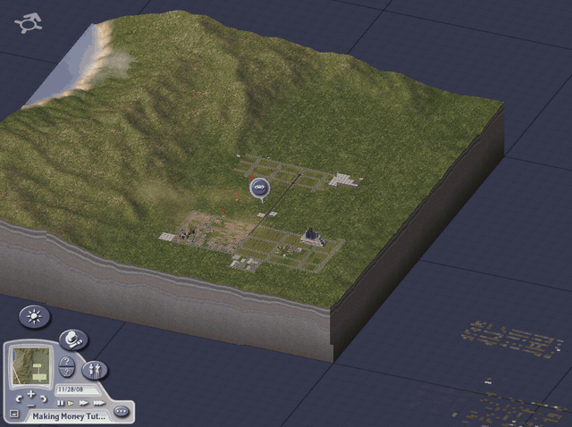
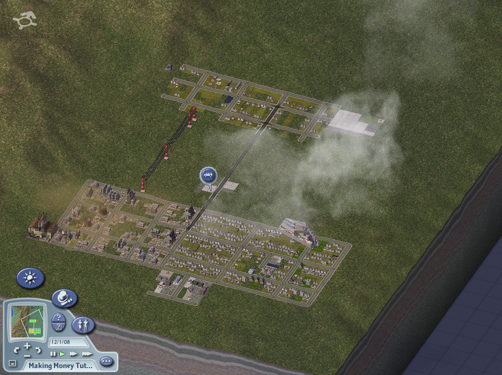
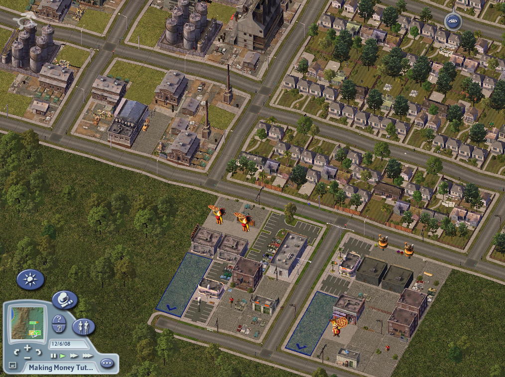
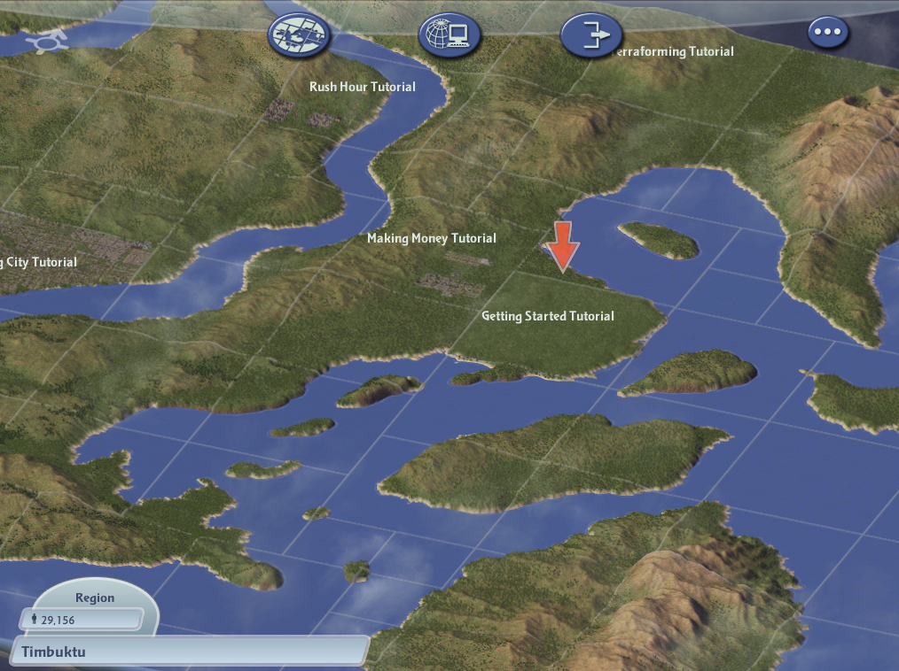

# SimCity 4 Deluxe — Static Recompilation



Static recompilation of **SimCity 4 Deluxe** (Maxis, Steam build of
`SimCity 4.exe`, linked 2010-06-11 with MSVC 7.1) from its shipping binary to
native C, hosted on pcrecomp's `native32` runtime. No emulator.

Built on the [pcrecomp](https://github.com/sp00nznet/pcrecomp) toolchain and
following its shared house style for recompilation projects.

**Generated source is not distributed.** You supply your own copy of the game;
the lifter runs on your machine and writes the C into a gitignored folder.

## Status

**Early but playable.** The whole game lifts with no errors. On OpenGL the
recompiled program loads a region, enters a city, simulates it and saves it,
and the shipping game loads that save. Scripted runs check this end to end:
see [docs/RECON.md](docs/RECON.md) for the binary and the bring-up.

| Area | State |
|---|---|
| Steam wrapper | Removed statically |
| Function catalog | 50,604 functions, 97% of `.text`, from disasm32 seeded with 18,437 vtable methods |
| Lift | 50,766 functions, 0 lift errors, 10.2M lines of C |
| OpenGL driver | Regions and cities, windowed. Fixed along the way: white terrain, pale water, black squares on lots, and a stray blue wedge that is a bug in the game itself |
| Simulation and saves | A month of a city simulated and saved; the original game loads the save with the same population and funds |
| Software driver | Splash and main menu, matching the original's frames |
| Sound | Works with an audio device, muted by default (`--sound` to hear it) |
| DirectX 7 driver | Not tried: it asks for exclusive fullscreen |

Not yet: a full play session by hand, day/night lighting checked against the
original, and the extras on the [roadmap](ROADMAP.md) (camera, recording, a
settings menu).

## Screenshots

The recompiled game's own frames, on OpenGL (`--snap`):

| | |
|---|---|
|  |  |
| The Making Money tutorial city | Zoomed in |
|  |  |
| The Timbuktu region | The splash screen |

## Getting Started

You need Windows 10/11, your own **SimCity 4 Deluxe** installed (Steam), Visual
Studio 2022 (or its Build Tools) with *Desktop development with C++*, and about
3 GB free. pcrecomp is expected beside this folder (`..\pcrecomp`); the setup
downloads it if it is missing.

### Installer

The easiest way: download `SimCity4-Recomp-Installer-windows-x64.exe` from the
[latest release](https://github.com/sp00nznet/simcity4/releases/latest). It
finds your Steam copy, builds, and gives you a **Play** button.

### Quick start

Double-click `Setup.cmd`. It checks Python, CMake and Ninja (asking before it
installs anything), finds your Steam copy, links it as `game\`, removes the
Steam wrapper into `work\sc4.exe`, builds the catalog, lifts, builds, and
leaves `SimCity 4 (recomp).cmd`. A rerun skips finished steps. Details go to
`setup.log`.

### Step by step

```
mklink /J game "E:\SteamLibrary\steamapps\common\SimCity 4 Deluxe"
py -3 ..\pcrecomp\tools\drm\steamstub.py "game\Apps\SimCity 4.exe" work\sc4.exe
py -3 ..\pcrecomp\tools\cpp\vtable_scan.py work\sc4.exe --seeds work\vtable_seeds.json
py -3 ..\pcrecomp\tools\disasm\disasm32.py work\sc4.exe -o work\functions.json --seed-functions work\vtable_seeds.json
py -3 run_lift.py --all
build.cmd
build\sc4.exe --run --watchdog 60
```

Expected from the unwrap: `SteamStub 2.x: app 24780 ... .text 0x00407000+0x679000 not encrypted; OEP 0x009F15DC`.

Trip-ups: use `py -3`, not the Microsoft Store `python` alias; a freshly
installed tool needs a new terminal window to be on `PATH`.

## Usage

```
build\sc4.exe                      dry run: map and bind the image, then stop
build\sc4.exe --run                run (muted; --sound to hear it)
build\sc4.exe --run --headless     no window on screen, message boxes printed
build\sc4.exe --run --args "-intro:off -w -d:Software"   the game's own switches
build\sc4.exe --run --original     the shipping machine code under the same host (to compare)
build\sc4.exe --run --headless --snap shots --snap-every 500   save every 500th frame as a BMP
buildsc4.exe --run --snap shots --snap-every 3 --snap-from 2400   every 3rd frame from frame 2400 (for a GIF)
build\sc4.exe --run --spy 877D7A   log the indirect calls one lifted function makes
```

Every run keeps the game's Documents folder in `work\docs`, never your
`Documents\SimCity 4` (`--user-docs` to use the real one). `--monitor N` puts
the window on display N. `NATIVE32_TRACE_EH=1` traces guest C++ exceptions.

## Building from source

`build.cmd` (MSVC x86 + CMake + Ninja) builds `build\sc4.exe` from
`src\recomp\gen\`, which `run_lift.py` writes. Pass `-DPCRECOMP=<path>` in
`CMAKE_ARGS` to use a different toolkit checkout.

## License

The host and scripts here are MIT ([LICENSE](LICENSE)). SimCity 4 is © Maxis /
Electronic Arts; no game files, and nothing generated from them, are in this
repository.
