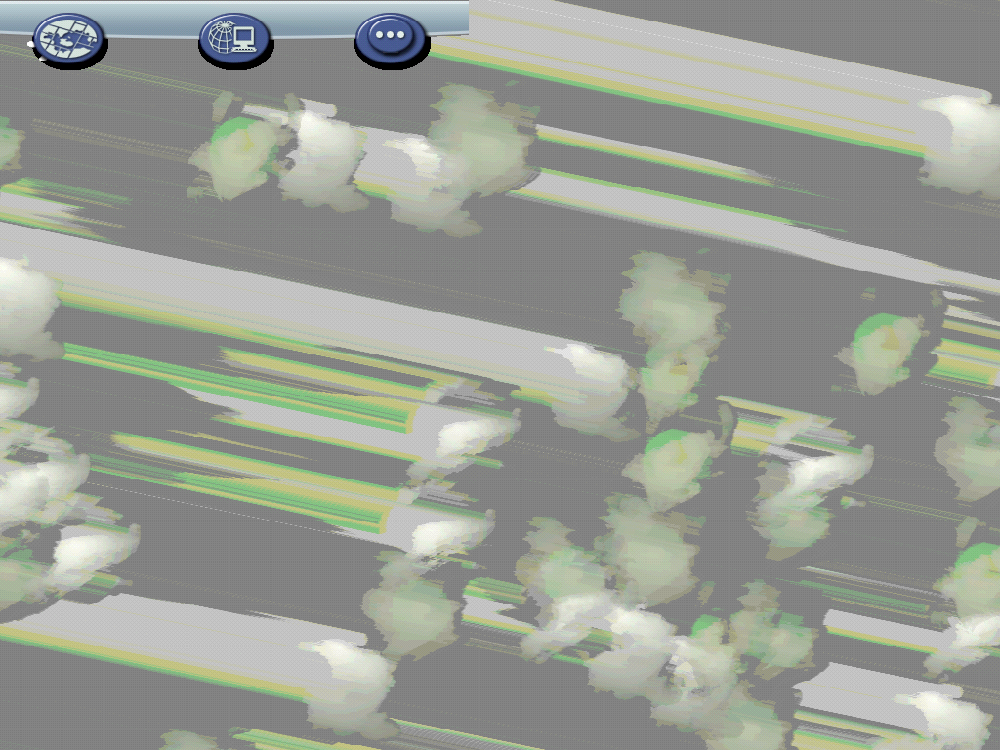

# SimCity 4 Deluxe — Static Recompilation

Static recompilation of **SimCity 4 Deluxe** (Maxis, Steam build of
`SimCity 4.exe`, linked 2010-06-11 with MSVC 7.1) from its shipping binary to
native C, hosted on pcrecomp's `native32` runtime. No emulator.

Built on the [pcrecomp](https://github.com/sp00nznet/pcrecomp) toolchain and
following its shared house style for recompilation projects.

**Generated source is not distributed.** You supply your own copy of the game;
the lifter runs on your machine and writes the C into a gitignored folder.

## Status

**P1, boots to the main menu.** The whole game lifts with no errors and the
recompiled program runs headless through its startup into the main menu on the
software renderer, frame for frame like the original code under the same host.
Nothing is played yet: there is no input scripting, and a region has not been
loaded. See [docs/RECON.md](docs/RECON.md) for the binary and the bring-up.

| Area | State |
|---|---|
| Steam wrapper | Removed statically (needs pcrecomp#149) |
| Function catalog | 50,604 functions, 97% of `.text`, from disasm32 seeded with 18,437 vtable methods |
| Lift | 50,766 functions, 0 lift errors, 10.2M lines of C |
| Startup | CRT, GZCOM framework, app init, main loop (all lifted) |
| Rendering | Software driver: splash and main menu, matching the original's frames; the generated span code runs natively (needs pcrecomp#153) |
| Sound | Off on a machine with no audio device (`-audio:off` is added); not tested with one |
| DirectX 7 / OpenGL drivers | Not tried yet (headless falls back to software) |
| Input, regions, cities | Not tried yet |

## Screenshots

Captured headless with `--snap` (the recompiled game's own frames, nothing on screen):

| | |
|---|---|
|  |  |
| The splash screen, loading in | The main menu over its clouds |

The cloud streaks are the game's: the shipping code under the same host draws
the same ([main-menu-original.png](docs/screenshots/main-menu-original.png)).

## Getting Started

You need Windows 10/11, your own **SimCity 4 Deluxe** installed (Steam), Visual
Studio 2022 (or its Build Tools) with *Desktop development with C++*, and about
3 GB free. pcrecomp is expected beside this folder (`..\pcrecomp`); until
its open PRs merge (#149 for the Steam wrapper, #153 for the generated-code support in
native32), build against a checkout that has both.

### Quick start

Double-click `Setup.cmd`. It checks Python, CMake and Ninja (asking before it
installs anything), finds your Steam copy, links it as `game\`, removes the
Steam wrapper into `work\sc4.exe`, builds the catalog, lifts, builds, and
leaves `SimCity 4 (recomp).cmd`. A rerun skips finished steps. Details go to
`setup.log`.

### Step by step

```
mklink /J game "E:\SteamLibrary\steamapps\common\SimCity 4 Deluxe"
py -3 ..\pcrecomp\tools\drm\steamstub.py "game\Apps\SimCity 4.exe" work\sc4.exe
py -3 ..\pcrecomp\tools\cpp\vtable_scan.py work\sc4.exe --seeds work\vtable_seeds.json
py -3 ..\pcrecomp\tools\disasm\disasm32.py work\sc4.exe -o work\functions.json --seed-functions work\vtable_seeds.json
py -3 run_lift.py --all
build.cmd
build\sc4.exe --run --watchdog 60
```

Expected from the unwrap: `SteamStub 2.x: app 24780 ... .text 0x00407000+0x679000 not encrypted; OEP 0x009F15DC`.

Trip-ups: use `py -3`, not the Microsoft Store `python` alias; a freshly
installed tool needs a new terminal window to be on `PATH`.

## Usage

```
build\sc4.exe                      dry run: map and bind the image, then stop
build\sc4.exe --run                run (muted; --sound to hear it)
build\sc4.exe --run --headless     no window on screen, message boxes printed
build\sc4.exe --run --args "-intro:off -w -d:Software"   the game's own switches
build\sc4.exe --run --original     the shipping machine code under the same host (to compare)
build\sc4.exe --run --headless --snap shots --snap-every 500   save every 500th frame as a BMP
build\sc4.exe --run --spy 877D7A   log the indirect calls one lifted function makes
```

Headless runs keep the game's Documents folder in `work\docs`, never your
`Documents\SimCity 4`. `NATIVE32_TRACE_EH=1` traces guest C++ exceptions.

## Building from source

`build.cmd` (MSVC x86 + CMake + Ninja) builds `build\sc4.exe` from
`src\recomp\gen\`, which `run_lift.py` writes. Pass `-DPCRECOMP=<path>` in
`CMAKE_ARGS` to use a different toolkit checkout.

## License

The host and scripts here are MIT ([LICENSE](LICENSE)). SimCity 4 is © Maxis /
Electronic Arts; no game files, and nothing generated from them, are in this
repository.
